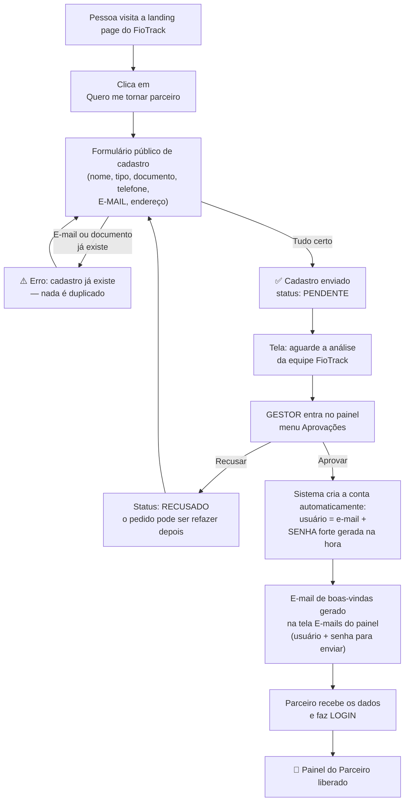
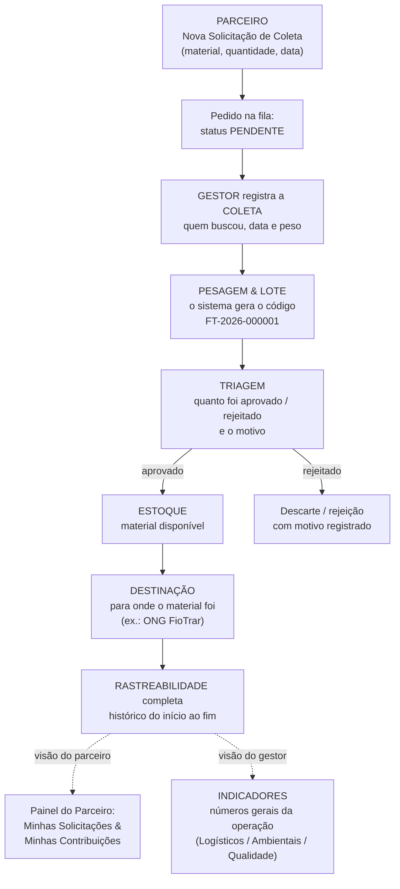
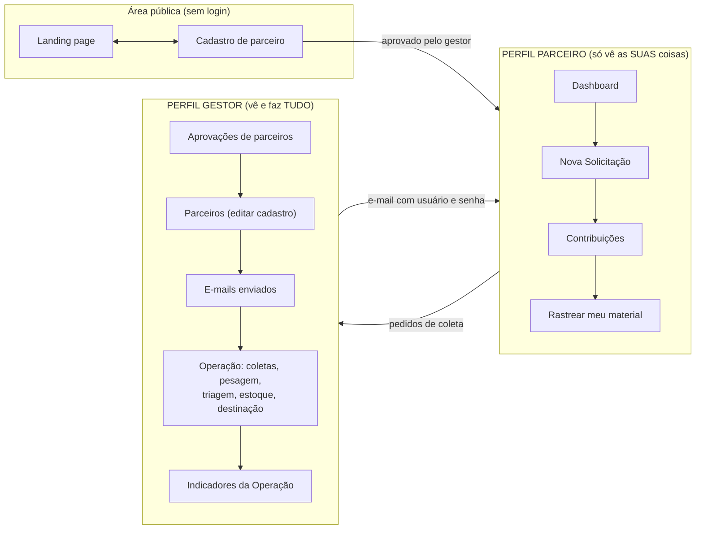

# Fluxograma do FioTrack — como tudo funciona

> Guia visual em linguagem simples. Abra este arquivo no navegador ou use a visualização de diagrama do editor.

---

## 1️⃣ Fluxo do cadastro de parceiros (do interesse ao acesso liberado)

---

## 2️⃣ Fluxo da operação logística (o material percorrendo o caminho)

---

## 3️⃣ Quem é quem (os dois perfis)

---

## 🎨 Legenda dos ícones

| Símbolo | Significado |
|---|---|
| ✅ | Algo foi aceito / criado com sucesso |
| ⚠️ | Atenção: algo bloqueado ou errado |
| 🎉 | Fim do caminho: tela liberada |
| seta sólida | passo seguinte na ordem |
| seta pontilhada | visão de um dos perfis |
